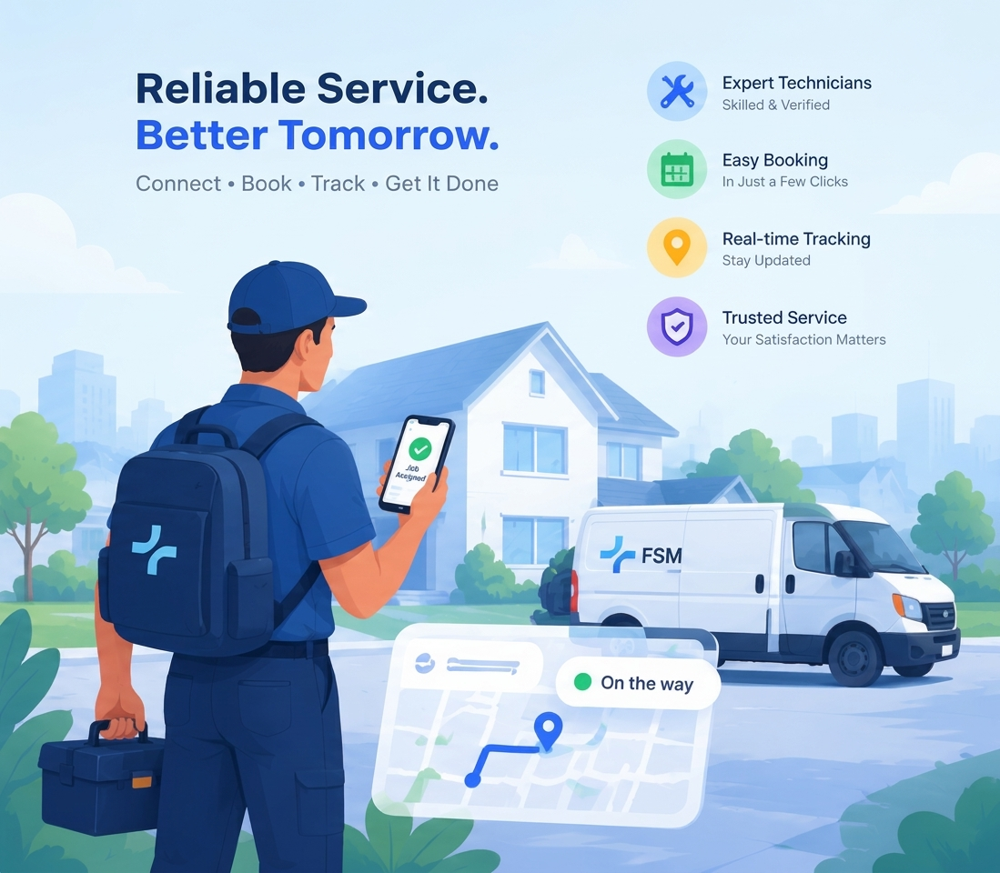

<div align="center">


# Field Service Management System

### Frontend Application

**A role-based web platform that manages the complete life cycle of an on-site service business — from the customer's request to technician dispatch, work completion, bKash payment and feedback.**

<br />

[](https://field-service-management-system-fro.vercel.app)
[](https://field-service-management-system-bac.vercel.app)


<br />



</div>

---

## 🔗 Live Links

| Service                | URL                                                                                                      |
| ---------------------- | -------------------------------------------------------------------------------------------------------- |
| 🌐 **Frontend (Live)** | [field-service-management-system-fro.vercel.app](https://field-service-management-system-fro.vercel.app) |
| ⚙️ **Backend API**     | [field-service-management-system-bac.vercel.app](https://field-service-management-system-bac.vercel.app) |
| 📡 **API Base URL**    | `https://field-service-management-system-bac.vercel.app/api/v1`                                          |

### 🔑 Try it instantly — Demo Login

Open the [login page](https://field-service-management-system-fro.vercel.app/login) and click one of the **Demo Login** buttons, or sign in manually:

| Role              | Email                 | Password    |
| ----------------- | --------------------- | ----------- |
| 👑 **Admin**      | `admin@demo.com`      | `Demo@1234` |
| 👤 **Customer**   | `customer@demo.com`   | `Demo@1234` |
| 🛠️ **Technician** | `technician@demo.com` | `Demo@1234` |

> Demo accounts are for exploration only. Please do not store sensitive information.

---

## 📑 Table of Contents

1. [Overview](#-overview)
2. [Key Features](#-key-features)
3. [Roles & Dashboards](#-roles--dashboards)
4. [Business Workflow](#-business-workflow)
5. [Tech Stack](#-tech-stack)
6. [Getting Started](#-getting-started)
7. [Environment Variables](#-environment-variables)
8. [Available Scripts](#-available-scripts)
9. [Project Structure](#-project-structure)
10. [Architecture & Conventions](#-architecture--conventions)
11. [Authentication & Route Protection](#-authentication--route-protection)
12. [Payment Flow (bKash)](#-payment-flow-bkash)
13. [Deployment](#-deployment)

---

## 📖 Overview

This repository contains the **frontend** of the Field Service Management (FSM) system — a Next.js (App Router) application that consumes the [FSM Backend REST API](https://field-service-management-system-bac.vercel.app) (`/api/v1`).

Three user roles — **Customer**, **Technician** and **Admin** — each get their own dashboard, navigation and permissions:

| Role              | What they do                                                                                                            |
| ----------------- | ----------------------------------------------------------------------------------------------------------------------- |
| 👤 **Customer**   | Book services, track progress, pay invoices with bKash and leave feedback.                                              |
| 🛠️ **Technician** | Confirm assignments, run work orders on site, upload service reports and monitor personal performance.                  |
| 👑 **Admin**      | Review requests, assign technicians, verify work, issue invoices and monitor the business via analytics and audit logs. |

---

## ✨ Key Features

### 🌐 Public Site

- Marketing pages: **Home, Services, About Us, Contact Us**
- Customer registration with **email OTP verification**, login, **Google login**, forgot / reset password
- **Technician application** with document upload and email OTP verification
- One-click **demo login** for Admin, Customer and Technician

### 👤 Customer

- Create service requests with priority and up to 5 attachments
- Track request status and cancel pending requests
- View invoices, **pay online with bKash**, download invoice PDF
- Give and edit feedback after the job is completed

### 🛠️ Technician

- Confirm or cancel assignments
- Work-order status flow: _en route → arrived → in progress → completed_
- Manage parts used, attachments and service report
- Manage skills and availability; personal performance dashboard and feedback

### 👑 Admin

- Review service requests (under review / approve / reject)
- Find available technicians and create, reschedule or cancel assignments (schedule-conflict aware)
- Verify work orders, create invoices and issue refunds
- Technician onboarding review, skills CRUD, user management (block / unblock / delete)
- Analytics dashboard, technician leaderboard and **audit logs**

### ⚙️ Platform

- In-app notifications with unread badge
- Server-driven pagination, search, filters and sorting synced to the URL
- Interactive charts powered by Recharts
- Loading skeletons, route-level error boundaries, empty states and confirm dialogs
- Fully responsive UI built on shadcn/ui

---

## 🧭 Roles & Dashboards

| Role         | Dashboard path | Main areas                                                                                                                    |
| ------------ | -------------- | ----------------------------------------------------------------------------------------------------------------------------- |
| `CUSTOMER`   | `/dashboard`   | Service requests, payments, feedbacks, notifications, profile                                                                 |
| `TECHNICIAN` | `/technician`  | Assignments, work orders, skills, performance, feedbacks, notifications, profile                                              |
| `ADMIN`      | `/admin`       | Service requests, assignments, work orders, technicians, performance, invoices, feedbacks, skills, users, audit logs, profile |

Each area is accessible only by its own role; users who open another role's area are redirected to their own dashboard.

---

## 🔄 Business Workflow

```text
Customer creates Service Request           PENDING
        │
Admin reviews → approves / rejects         UNDER_REVIEW → APPROVED | REJECTED
        │
Admin assigns a technician + time slot     Assignment: PENDING
        │
Technician confirms → Work Order created   SCHEDULED
        │
Technician: en route → arrived → start → complete
        │                                  TECHNICIAN_EN_ROUTE → ARRIVED → IN_PROGRESS → COMPLETED
Admin verifies the work order              VERIFIED
        │
Admin creates invoice → Customer pays      UNPAID → PAID  (bKash)
        │
Request becomes COMPLETED → Customer leaves feedback
```

---

## 🧰 Tech Stack

| Category        | Technology                                                              |
| --------------- | ----------------------------------------------------------------------- |
| Framework       | [Next.js 16](https://nextjs.org/) (App Router, React Compiler)          |
| UI library      | React 19, TypeScript 5                                                  |
| Styling         | Tailwind CSS v4, `tw-animate-css`, `class-variance-authority`           |
| Components      | shadcn/ui (`base-nova` style) on `@base-ui/react`, `lucide-react`       |
| Server state    | [TanStack Query](https://tanstack.com/query) v5                         |
| Forms           | [TanStack Form](https://tanstack.com/form) + [Zod](https://zod.dev/) v4 |
| HTTP client     | [ofetch](https://github.com/unjs/ofetch) with automatic token refresh   |
| Client state    | Zustand                                                                 |
| Charts          | Recharts                                                                |
| Auth            | Cookie-based JWT (backend) + `@react-oauth/google`                      |
| Dates / OTP     | `date-fns`, `react-day-picker`, `input-otp`                             |
| Lint & format   | [Biome](https://biomejs.dev/)                                           |
| Package manager | [Bun](https://bun.sh/)                                                  |
| Hosting         | [Vercel](https://vercel.com/)                                           |

---

## 🚀 Getting Started

### Prerequisites

- [Bun](https://bun.sh/) 1.x (or Node.js 20+ with npm / pnpm)
- _(Optional)_ A Google OAuth client ID for Google login

The frontend is already wired to the **hosted backend**, so no local backend setup is required.

### Installation

```bash
# 1. Clone the repository
git clone <your-frontend-repo-url>
cd Field-Service-Management-Frontend

# 2. Install dependencies
bun install

# 3. Configure environment
cp .env.example .env.local
#    then fill in the values (see "Environment Variables" below)

# 4. Start the development server
bun dev
```

Or skip the setup and use the live app: **<https://field-service-management-system-fro.vercel.app>**

> **Note:** the backend's `FRONTEND_URL` (used for CORS and the payment redirect) must match the frontend origin you are using. If you run the frontend from a different origin, ask the backend owner to allow it.

---

## 🔐 Environment Variables

Create a `.env.local` file in the project root:

```env
# --- Required ---
NEXT_PUBLIC_API_BASE_URL=https://field-service-management-system-bac.vercel.app/api/v1

# --- Optional ---
NEXT_PUBLIC_SITE_URL=https://field-service-management-system-fro.vercel.app
NEXT_PUBLIC_GOOGLE_CLIENT_ID=<your-google-oauth-client-id>

# Demo accounts used by the one-click demo login
NEXT_PUBLIC_DEMO_ADMIN_EMAIL=admin@demo.com
NEXT_PUBLIC_DEMO_ADMIN_PASSWORD=Demo@1234
NEXT_PUBLIC_DEMO_CUSTOMER_EMAIL=customer@demo.com
NEXT_PUBLIC_DEMO_CUSTOMER_PASSWORD=Demo@1234
NEXT_PUBLIC_DEMO_TECHNICIAN_EMAIL=technician@demo.com
NEXT_PUBLIC_DEMO_TECHNICIAN_PASSWORD=Demo@1234
```

| Variable                       | Required | Description                                                                    |
| ------------------------------ | :------: | ------------------------------------------------------------------------------ |
| `NEXT_PUBLIC_API_BASE_URL`     |    ✅    | Backend API base URL including `/api/v1`                                       |
| `NEXT_PUBLIC_SITE_URL`         |    ➖    | Public site URL used for metadata                                              |
| `NEXT_PUBLIC_GOOGLE_CLIENT_ID` |    ➖    | Enables Google login. Use the same client ID as the backend `GOOGLE_CLIENT_ID` |
| `NEXT_PUBLIC_DEMO_*`           |    ➖    | Credentials for the demo-login buttons (defaults shown above)                  |

> ⚠️ All `NEXT_PUBLIC_*` values are exposed to the browser. Never put secrets in them.

---

## 📜 Available Scripts

| Script           | Description                          |
| ---------------- | ------------------------------------ |
| `bun dev`        | Start the development server         |
| `bun run build`  | Create an optimized production build |
| `bun start`      | Run the production build             |
| `bun run lint`   | Lint & check code with Biome         |
| `bun run format` | Format code with Biome               |

---

## 🗂️ Project Structure

```text
src
├── api/              # One file per backend module (thin wrappers over apiClient)
├── app/              # Next.js App Router
│   ├── (public)/     #   marketing pages + authentication pages
│   └── (dashboard)/  #   admin/, technician/, dashboard/ (customer) areas
├── assets/           # SVG logo and static assets
├── components/
│   ├── auth/         #   AuthGuard, RoleGuard, GuestGuard, access denied
│   ├── common/       #   PageHeader, StatCard, StatusBadge, FilterBar, ConfirmDialog …
│   ├── dashboard/    #   Dashboard shell, sidebar, user menu
│   ├── form/         #   Login, register, OTP, reset-password, technician-apply forms
│   ├── layout/       #   Public header & footer
│   ├── modules/      #   Feature UIs (analytics, assignment, payment, work-order …)
│   └── ui/           #   shadcn/ui primitives
├── constants/        # Roles, statuses, query keys, demo accounts, site config
├── hooks/            # TanStack Query hooks, one file per module
├── lib/              # apiClient, token refresh, session helpers, utils, metadata
├── providers/        # Query & Google auth providers
├── routes/           # Per-role route maps and sidebar menus
├── store/            # Zustand stores (auth, UI)
├── types/            # TypeScript types mirroring backend responses
├── utils/            # Formatters, error and query-string helpers
├── validation/       # Zod schemas per module
└── proxy.ts          # Role-based route guard (Next.js 16 proxy)
```

**Backend modules covered:** `auth` · `user` · `admin-user` · `audit-log` · `skill` · `technician` · `service-request` · `assignment` · `work-order` · `payment` · `feedback` · `notification` · `analytics`

---

## 🏗️ Architecture & Conventions

**Layer order** — pages stay thin and never call the API directly:

```text
app (page)  →  components/modules  →  hooks  →  api  →  lib/apiClient
```

- **Four files per module:** `types/*.type.ts`, `api/*.api.ts`, `hooks/*.hook.ts`, `validation/*.validation.ts`.
- **Pages** only compose components; logic lives in `components/modules/<module>/`.
- **Server state** lives in TanStack Query (central keys in `constants/query-keys.constant.ts`); **client state** (current user, UI) lives in Zustand.
- **Forms** use TanStack Form with Zod schemas from `validation/`.
- **Roles** are `ADMIN | TECHNICIAN | CUSTOMER`, matching the backend enum exactly.
- **API response shape:** `{ success, message, data, meta? }` — typed in `types/api.type.ts`.
- **Code style** is enforced by Biome (`bun run lint`).

---

## 🛡️ Authentication & Route Protection

1. The backend issues `accessToken` and `refreshToken` as **httpOnly cookies**; the frontend sends them with `credentials: "include"`.
2. `lib/apiClient.ts` automatically calls `/auth/refresh-token` when a request returns `401` and retries the original request once (auth endpoints are excluded).
3. `AuthGuard`, `RoleGuard` and `GuestGuard` protect dashboard and auth pages on the client using the current user (`/auth/me`).
4. `src/proxy.ts` runs before the page renders and uses a small **`fsm_role` routing cookie** (set by the frontend on login) to redirect:
   - signed-out users → `/login`
   - users in the wrong area → their own dashboard
5. The `fsm_role` cookie is only a UX hint. **All real authorization is enforced by the backend** on every request.

> The frontend and backend are deployed on separate Vercel domains, so the backend must set cookies with the correct `SameSite` / `Secure` options and allow the frontend origin in CORS.

---

## 💳 Payment Flow (bKash)

1. Admin creates an invoice for a verified work order.
2. Customer clicks **Pay with bKash** on the invoice → the frontend calls `POST /payment/initiate` and redirects the browser to the returned `bkashURL`.
3. After payment, bKash calls the backend callback, which verifies the transaction server-side.
4. The backend redirects back to `/dashboard/payments?status=success|failure|cancel` on the [live frontend](https://field-service-management-system-fro.vercel.app), where a result banner is shown.
5. Customers and admins can download the invoice as a PDF.

> Use bKash **sandbox** wallet credentials when testing.

---

## ☁️ Deployment

Both apps are deployed on **Vercel**:

| App      | URL                                                    |
| -------- | ------------------------------------------------------ |
| Frontend | https://field-service-management-system-fro.vercel.app |
| Backend  | https://field-service-management-system-bac.vercel.app |

To deploy your own copy:

1. Import the repository into [Vercel](https://vercel.com/new).
2. Add the environment variables listed [above](#-environment-variables).
3. Deploy — Vercel detects Next.js automatically.

Checklist:

- [ ] `NEXT_PUBLIC_API_BASE_URL` points to `https://field-service-management-system-bac.vercel.app/api/v1`
- [ ] Backend `FRONTEND_URL` is set to `https://field-service-management-system-fro.vercel.app` (CORS + payment redirect)
- [ ] Both apps are served over **HTTPS** so `Secure` cookies work
- [ ] The frontend domain is added to the Google OAuth client's authorized origins
- [ ] The bKash callback URL points to the deployed backend

---

<div align="center">

**Built with ❤️ using Next.js, TanStack and shadcn/ui**

[🌐 Live Demo](https://field-service-management-system-fro.vercel.app) · [⚙️ Backend API](https://field-service-management-system-bac.vercel.app)

</div>
